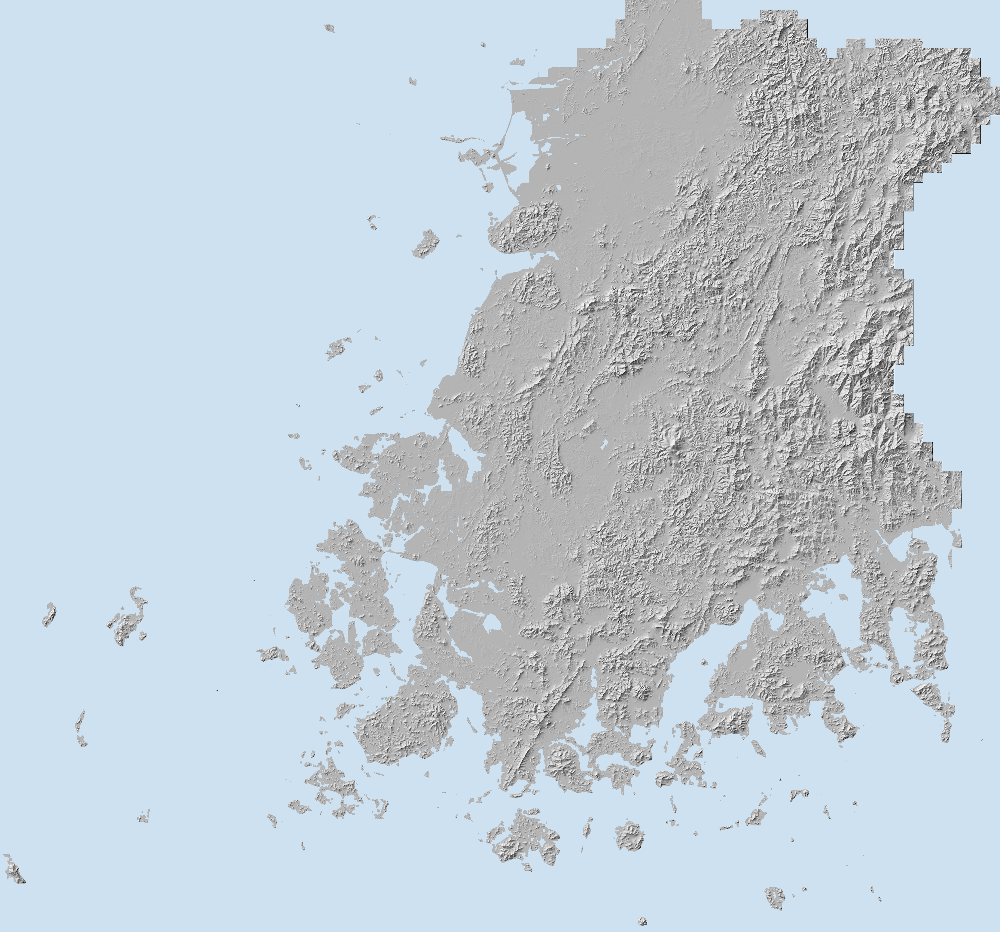

# site-agent-terrain

[대지해석 에이전트](https://cjg10040.github.io/site-agent/)가 쓰는 **지형 격자 타일**입니다 (전남광주통합특별시·전북특별자치도).

- 원자료: 국토지리정보원 연속수치지형도 등고선(5m 간격)·표고점 — 브이월드 공간정보 다운로드, **CC BY** (출처: 국토지리정보원)
- 가공: 등고선 정점과 표고점으로 들로네 삼각망을 만들어 **10m 격자**로 보간 (가장 가까운 자료가 400m보다 먼 칸은 자료 없음)
- 타일: EPSG:5179(UTM-K) 2,560m × 2,560m = 256 × 256칸, 이름 `dem/{열}_{행}.png` (열 = floor(x/2560), 행 = floor(y/2560))
- 값: PNG RGB — `v = R×256 + G`, 높이(m) = `v/10 − 1000`, `B = 0`이면 자료 없음. 0행이 북쪽
- 목록: `dem/manifest.json` (버전 2026.1, 타일 4,483장)
- 한계: 10m 격자라 옹벽·계단·작은 둔덕은 나타나지 않음. 참고용이며 측량·인허가 근거가 아님
- 만드는 방법: 앱 저장소 `tools/terrain/` (T0 조사 → T1 색인 → T2 격자화 → T4 검증 → T5 배포), 계획은 `docs/지형자료_가공계획서.md`

---

# T4 지형 타일 검증

- 검증일: 2026-11-10 22:41
- 타일 4,483장, 합계 199.8MB (평균 45.6KB)

## ① 기준 산 높이 (반경 500m 안 가장 높은 칸)

| 산 | 공식 높이 | 격자 | 차이 | 꼭대기까지 |
|---|---|---|---|---|
| 무등산 천왕봉 | 1,187.0m | 1,185.0m | -2.0m ✅ | 10m |
| 덕유산 향적봉 | 1,614.0m | 1,613.5m | -0.5m ✅ | 30m |
| 지리산 반야봉 | 1,732.0m | 1,731.5m | -0.5m ✅ | 367m |
| 지리산 노고단 | 1,507.0m | 1,501.7m | -5.3m ⚠️ | 193m |
| 모악산 | 793.5m | 794.2m | +0.7m ✅ | 14m |
| 월출산 천황봉 | 809.0m | 808.6m | -0.4m ✅ | 382m |

## ② 시험 대지

- 광주 충장로3가 17-5 (시험 대지): 격자 44.9m, sitedia(같은 원자료 10m 격자) 44.9m → 차이 +0.0m ✅

## ③ 타일 이음매 (가로 이웃 타일 800쌍 표본)

- 이웃 타일 가장자리 칸 차이: 평균 1.05m, 95% 4.40m
- 같은 타일 안 이웃 칸 차이: 평균 0.95m, 95% 4.30m
- 두 값이 비슷하면 이음매 없음 ✅

## ④ 표고점 위치의 격자 값 − 표고점 (입력 점이므로 칸 크기 10m 안의 차이만 있어야 함)

- 표본 2,887개: 중앙 0.29m, 95% 1.91m, 최대 13.5m

## ⑤ 미리보기

- 검증 시간 9초
